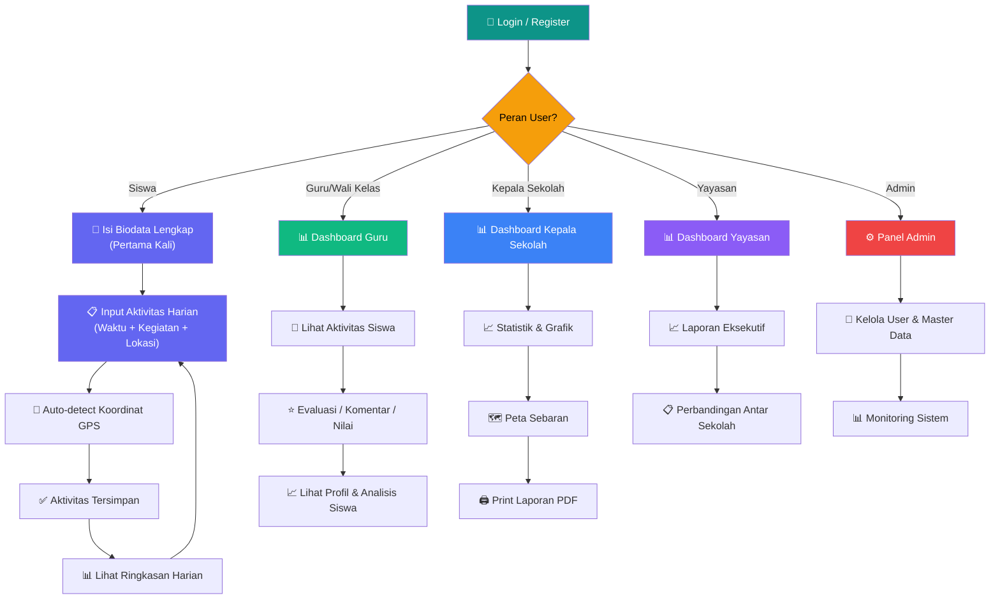
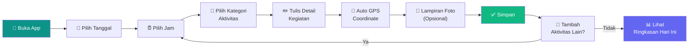
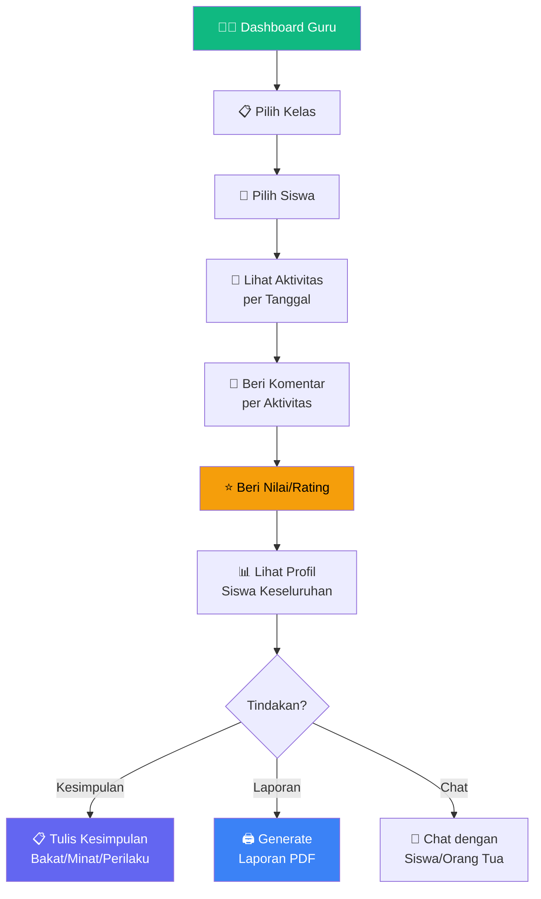
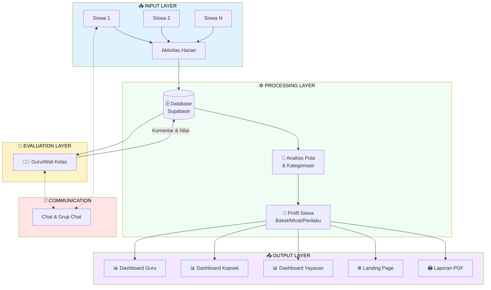
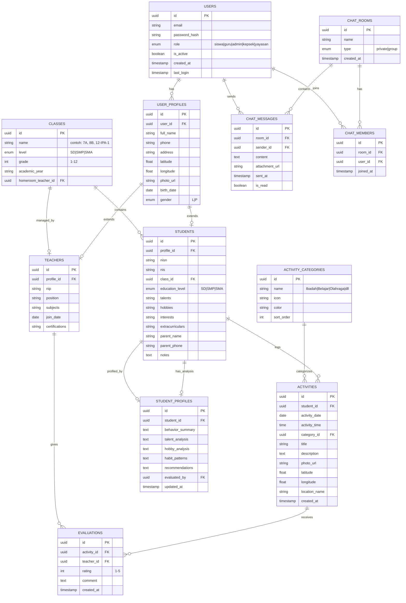
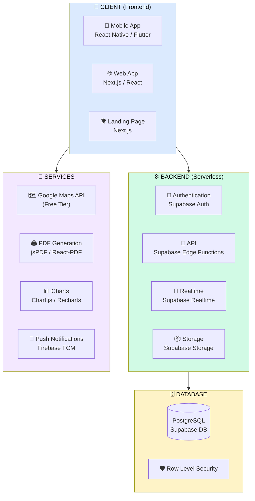
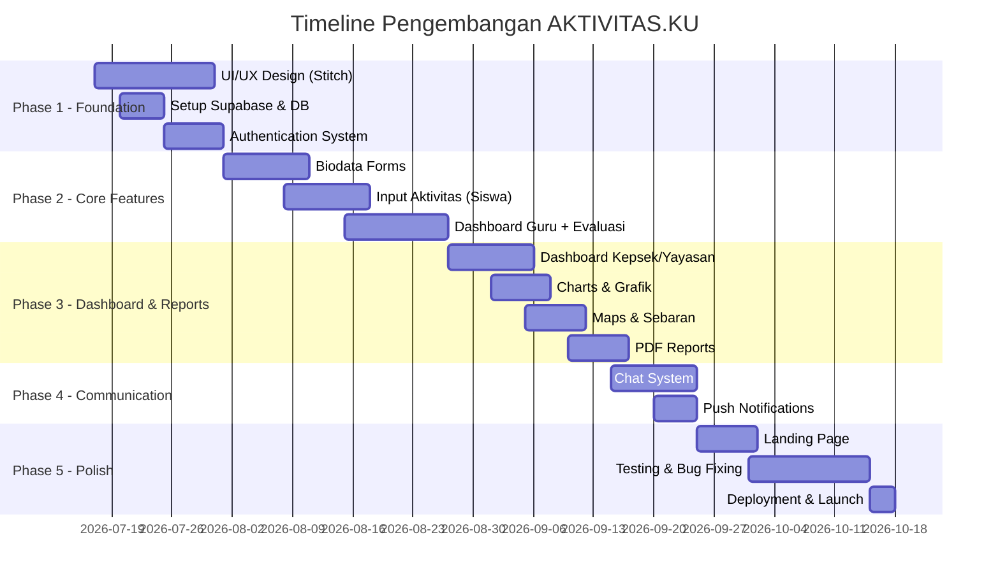

# 📋 PERENCANAAN SISTEM — YASPEN BUDI UTOMO
## Sistem Pencatatan & Monitoring Aktivitas Siswa dan Guru

---

## 🏷️ Rekomendasi Nama Aplikasi

| No | Nama | Arti / Alasan |
|----|------|---------------|
| 1 | **AKTIVITAS.KU** ⭐ | Singkat, personal ("ku" = milik saya), mudah diingat siswa. Domain-friendly. |
| 2 | **BUDIKU** | Gabungan "Budi Utomo" + "Ku" (milik saya). Menunjukkan identitas yayasan. |
| 3 | **CATAKU** | "Catatan Aktivitasku" — ringkas, catchy, menggambarkan fungsi utama. |
| 4 | **PANTAU.ID** | Menggambarkan monitoring/pemantauan. Profesional & modern. |
| 5 | **JEJAK BUDI** | "Jejak" = rekam jejak aktivitas, "Budi" = karakter/yayasan. Bermakna mendalam. |

> [!TIP]
> Rekomendasi terbaik: **AKTIVITAS.KU** — mudah diingat, personal, dan langsung menggambarkan fungsi aplikasi.

---

## 📖 Deskripsi Proyek

**YASPEN BUDI UTOMO** adalah sistem aplikasi berbasis mobile & web untuk Yayasan Pendidikan Budi Utomo yang bertujuan:

1. **Mencatat** seluruh aktivitas harian siswa secara real-time
2. **Memonitor** aktivitas siswa oleh Guru/Wali Kelas
3. **Mengevaluasi** dan memberikan penilaian/komentar terhadap aktivitas
4. **Melaporkan** data aktivitas kepada Kepala Sekolah & Yayasan
5. **Menganalisis** pola kebiasaan, perilaku, bakat, dan minat siswa
6. **Memfasilitasi** komunikasi antar stakeholder melalui fitur chat

---

## 👥 Identifikasi Pengguna (User Roles)

| Role | Akses | Fungsi Utama |
|------|-------|--------------|
| **🎒 Siswa** | Input & View Own | Input aktivitas harian, isi biodata, lihat evaluasi guru, chat |
| **👨‍🏫 Guru / Wali Kelas** | View & Evaluate | Monitor aktivitas siswa kelasnya, beri evaluasi/komentar/nilai, chat |
| **🏫 Kepala Sekolah** | View All | Lihat seluruh data, laporan, statistik, print PDF |
| **🏛️ Yayasan** | View All | Lihat seluruh data lintas sekolah, laporan eksekutif |
| **⚙️ Admin** | Full Access | Kelola user, master data, konfigurasi sistem, seluruh fitur |

---

## 🔄 Workflow / Alur Kerja Sistem

### Alur Utama (Main Flow)

### Alur Input Aktivitas Siswa (Detail)

### Alur Evaluasi Guru

### Alur Data Keseluruhan (System Flow)

---

## 🗃️ Desain Database (Entity Relationship)

### ERD (Entity Relationship Diagram)

---

## 📱 Fitur-Fitur Aplikasi (Per Role)

### 🎒 Fitur Siswa
| No | Fitur | Deskripsi |
|----|-------|-----------|
| 1 | Registrasi & Biodata | Form lengkap: Nama, NISN, foto, kelas, jenjang, bakat, hobi, minat, ekskul, alamat + GPS |
| 2 | Input Aktivitas Harian | Pilih tanggal → jam → kategori → deskripsi → foto (opsional) → auto GPS |
| 3 | Timeline Aktivitas | Tampilan kronologis aktivitas per hari seperti timeline |
| 4 | Lihat Evaluasi Guru | Notifikasi & tampilan komentar/nilai dari guru |
| 5 | Profil Pribadi | Ringkasan bakat, minat, kebiasaan berdasarkan data aktivitas |
| 6 | Chat | Chat pribadi dengan guru, grup kelas |
| 7 | Riwayat Aktivitas | Kalender & filter untuk melihat aktivitas sebelumnya |

### 👨‍🏫 Fitur Guru / Wali Kelas
| No | Fitur | Deskripsi |
|----|-------|-----------|
| 1 | Dashboard | Ringkasan: total siswa, aktivitas hari ini, belum dinilai, pesan baru |
| 2 | Daftar Siswa | List siswa per kelas dengan foto, status aktivitas hari ini |
| 3 | Monitor Aktivitas | Feed real-time aktivitas siswa dengan filter tanggal/kategori |
| 4 | Evaluasi & Komentar | Beri rating ⭐ (1-5) dan komentar per aktivitas |
| 5 | Profil & Analisis Siswa | Grafik pola aktivitas, kesimpulan bakat/minat/perilaku |
| 6 | Laporan PDF | Generate & print laporan per siswa/kelas/periode |
| 7 | Chat & Grup | Chat pribadi/grup dengan siswa |
| 8 | Peta Sebaran | Maps lokasi aktivitas siswa |

### 🏫 Fitur Kepala Sekolah
| No | Fitur | Deskripsi |
|----|-------|-----------|
| 1 | Dashboard Eksekutif | Statistik keseluruhan sekolah dengan grafik interaktif |
| 2 | Monitoring Per Kelas | Perbandingan aktivitas antar kelas |
| 3 | Peta Sebaran | Maps sebaran lokasi siswa & aktivitas |
| 4 | Grafik & Statistik | Bar chart, pie chart, line graph per kategori |
| 5 | Laporan PDF | Print laporan berbagai kategori & filter |
| 6 | Chat | Komunikasi dengan guru & staff |

### 🏛️ Fitur Yayasan
| No | Fitur | Deskripsi |
|----|-------|-----------|
| 1 | Dashboard Eksekutif | Overview seluruh unit sekolah (SD/SMP/SMA) |
| 2 | Laporan Lintas Sekolah | Perbandingan data antar jenjang |
| 3 | Statistik & Grafik | Visualisasi data keseluruhan |
| 4 | Laporan PDF | Laporan eksekutif untuk rapat yayasan |

### ⚙️ Fitur Admin
| No | Fitur | Deskripsi |
|----|-------|-----------|
| 1 | Kelola User | CRUD user semua role, reset password |
| 2 | Master Data | Kelola kelas, kategori aktivitas, tahun akademik |
| 3 | Kelola Konten | Landing page, foto dokumentasi, informasi |
| 4 | Monitoring Sistem | Log aktivitas, statistik penggunaan |
| 5 | Pengaturan | Konfigurasi umum aplikasi |
| 6 | Full Access | Semua fitur role lain |

---

## 🏗️ Arsitektur Teknologi

### Stack Teknologi yang Direkomendasikan

### Rekomendasi Tech Stack

| Layer | Teknologi | Alasan |
|-------|-----------|--------|
| **Mobile App** | **React Native (Expo)** | Cross-platform (iOS + Android), satu codebase, ekosistem besar |
| **Web App** | **React / Vite** | SSR/SSG, performa tinggi, modern development |
| **Backend** | **Supabase** ⭐ | PostgreSQL + Auth + Realtime + Storage, **GRATIS** tier cukup besar |
| **Database** | **Supabase (PostgreSQL)** | Relational, Row Level Security, realtime subscriptions |

---

## 📐 Struktur Halaman / Screens

### Sitemap Aplikasi

```mermaid
graph TD
    ROOT["🌐 AKTIVITAS.KU"] --> LANDING["Landing Page (Public)"]
    ROOT --> LOGIN["🔐 Login / Register"]
    
    LOGIN --> BIODATA["📝 Isi Biodata\n(Pertama Kali)"]
    
    BIODATA --> DASH_S["📱 Dashboard Siswa"]
    BIODATA --> DASH_G["📊 Dashboard Guru"]
    BIODATA --> DASH_KS["📊 Dashboard Kepsek"]
    BIODATA --> DASH_Y["📊 Dashboard Yayasan"]
    BIODATA --> DASH_A["⚙️ Dashboard Admin"]
    
    DASH_S --> S1["Input Aktivitas"]
    DASH_S --> S2["Timeline Harian"]
    DASH_S --> S3["Riwayat & Kalender"]
    DASH_S --> S4["Evaluasi dari Guru"]
    DASH_S --> S5["Profil Saya"]
    DASH_S --> S6["💬 Chat"]
    
    DASH_G --> G1["Daftar Siswa"]
    DASH_G --> G2["Monitor Aktivitas"]
    DASH_G --> G3["Evaluasi & Nilai"]
    DASH_G --> G4["Analisis Siswa"]
    DASH_G --> G5["Laporan & PDF"]
    DASH_G --> G6["💬 Chat"]
    DASH_G --> G7["🗺️ Peta Sebaran"]
    
    DASH_KS --> K1["Statistik Sekolah"]
    DASH_KS --> K2["Per Kelas"]
    DASH_KS --> K3["Grafik & Chart"]
    DASH_KS --> K4["🗺️ Peta Sebaran"]
    DASH_KS --> K5["Laporan & PDF"]
    
    DASH_A --> A1["Kelola User"]
    DASH_A --> A2["Master Data"]
    DASH_A --> A3["Kelola Konten"]
    DASH_A --> A4["Pengaturan"]
    
    LANDING --> LP1["Profil Yayasan"]
    LANDING --> LP2["Galeri Foto"]
    LANDING --> LP3["Statistik Publik"]
    LANDING --> LP4["🗺️ Peta"]
    LANDING --> LP5["Kontak"]
    
    style ROOT fill:#0D9488,color:#fff
    style LANDING fill:#6366F1,color:#fff
    style LOGIN fill:#F59E0B,color:#000
    style DASH_S fill:#10B981,color:#fff
    style DASH_G fill:#3B82F6,color:#fff
    style DASH_KS fill:#8B5CF6,color:#fff
    style DASH_Y fill:#EC4899,color:#fff
    style DASH_A fill:#EF4444,color:#fff
```

---

## 📅 Timeline Pengembangan (Estimasi)

